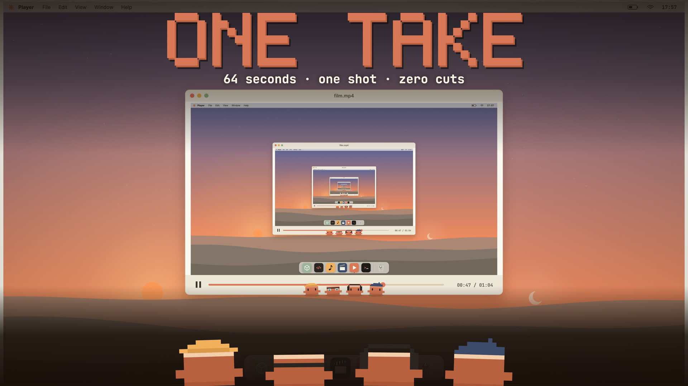

# ONE TAKE

**[▶ Download the film](https://github.com/laozhej/one-take/releases/download/v1.0.0/film-upload.mp4)** (MP4, 1080p, 64 s)

A 64-second film in a single continuous shot, with no cuts and a seamless loop, made entirely in code. It is one HTML page: Canvas 2D for the picture and Web Audio for the score. There are no image or audio files.

Claude Code's orange pixel character is the mouse cursor. It wakes at dawn, kicks the pointer into the Trash and types *"Make a video — and you're the protagonist."* Then:

- it splits into four agents (modeling, coding, music, editing);
- the four stamp beat markers on the real waveform, drag their clips into a timeline and stomp on **RENDER**;
- they ride the film's own frames as a roller coaster;
- they watch the film inside the film: an endless Droste zoom into this exact frame;
- they merge back into one, type the title and the production data;
- it puts the pointer back where it was, and the last frame leads into the first.

## Watch it

Open [`film/index.html`](film/index.html) in Chrome and click to play. It loops forever. It needs a network connection for its two Google fonts (Inter, JetBrains Mono).

| URL parameter | Effect |
|---|---|
| `?t=47` | freeze on one moment |
| `?ss=2` | draw at 2× (supersampled) |
| `?capture=1` | no player; tools drive `seek()` |

Keys: click or Space to play or pause, F for fullscreen.

## How it's made

- **Every frame is a pure function of time.** `window.__film.seek(t)` draws exactly the frame at `t` seconds, so any moment can be inspected and the export is frame-exact. `window.__film.wav()` returns the soundtrack as a base64 WAV.
- **One camera move.** Position and zoom follow a looping monotone spline, so position *and* velocity wrap at 64 s. The roller-coaster follow and the Droste push are blended in from computed paths.
- **Droste.** The player's screen is the whole desktop scaled by 0.45 about a fixed point. Each frame renders the world behind and in front of that screen at the reference camera, then composites them nine levels deep. The push zooms about the fixed point one level at a time, and each level lands exactly where the last began.
- **One day in 64 s.** The menu-bar clock reads 06:00 at frame 0 and 06:00 at 64 s. The night runs 3× faster, with eased transitions, so the light changes at the same rate on both sides of the loop. Dark mode follows the clock.
- **The score** is generated from the same timeline as the picture:
  - the typing is the hi-hat, and the beat-marker stomps are the kick;
  - a Shepard tone rises one octave per Droste level;
  - it renders offline in four parallel chunks, and anything past 64 s wraps onto the start, so the audio loop is sample-exact;
  - a circular compressor and a look-ahead limiter bring it to -14 LUFS.
- **Real data on screen:**
  - the waveform shows the final mix's peaks;
  - the piano roll shows the score's notes, and the music clone lands on each lead note as it sounds;
  - the code window scrolls this file's own source;
  - the film strip's frames are this film's frames;
  - the end card's counts (lines, bytes, notes) are measured by the page at runtime.

## Production data

| | |
|---|---|
| duration | 64.000 s · 1,920 frames at 30 fps |
| shots / cuts | 1 / 0 |
| tempo | 120 BPM · 32 bars · 128 beats |
| score | 693 notes · 3,072,000 samples at 48 kHz |
| source | 1,383 lines · 99.1 KB of JavaScript, as rendered for v1.0.0 (the page counts itself live, so later edits change these) |
| assets | 0 images · 0 audio files |

## Files

- `film/index.html`: the film, a single page.
- `film/FILM.md`: the director's treatment and the build notes.
- `film/cover/one-take-cover-1920.jpg`: the cover. It's drawn by the film's own engine: `window.__film.cover(t, zoom)` renders the 47.4 s frame zoomed into the Droste tunnel, and adds the four agents seen from behind and the title.
- `PROMPTS.md`: the prompts that made it.
- `tools/cover.mjs`: captures the cover at 2× in headless Chrome and scales it to 1920×1080. Usage: `node tools/cover.mjs film/index.html out.png 47.4 2.2`.
- `tools/`: the checks used while making it:
  - `seam.py`: frame-to-frame change across a loop point;
  - `audiocheck.mjs`: the audio loop seam and section levels;
  - `mp4check.sh`: frame count, colour tags, first and last frames.

The MP4 was exported frame by frame from headless Chrome: `seek(i / 30)` for each frame, drawn at 2× and scaled down, then encoded as H.264 with the generated WAV. That render pipeline comes from the `opus-js-animations` Claude Code skill and isn't included here.

## Credits

Made with Claude Code (Claude Opus 5.5). Claude, Claude Code and its pixel mascot belong to Anthropic.
